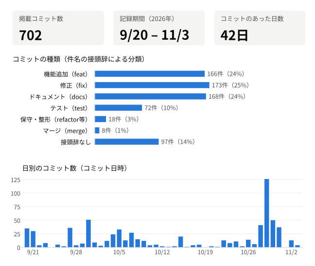
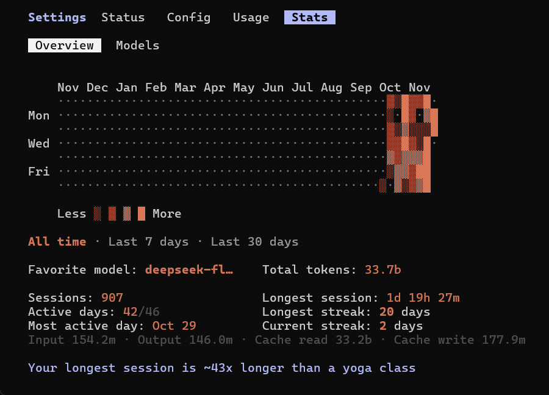
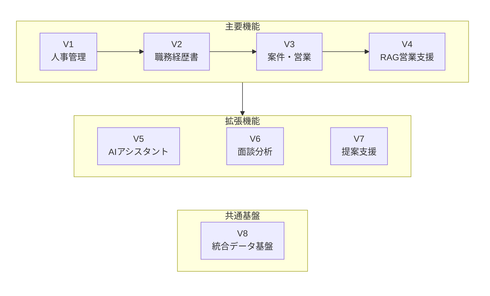

# SES業務・AI支援プラットフォーム 開発記録

日本のSES企業の人事・営業業務を想定し、人事管理を基盤として、職務経歴書の解析、案件マッチング、生成AIによる営業判断支援へと機能を広げてきた業務システムの、個人開発の記録です。

- **開発者**：郭 熙臣（コウ シーチェン）
- **開発形態**：個人開発（企画・設計から実装・検証までを主導）
- **開発期間**：2025年10月〜（このリポジトリの詳細な記録は、2026年9月のV1基準版から始まります）

> ソースコードと開発用のGitリポジトリは非公開です。このリポジトリでは、開発用リポジトリの実際のコミット履歴から件名や日時などを抜き出し、機密情報を伏せて掲載しています。

※このリポジトリに掲載しているコミットを集計しています（同じSHAは1件として数えます）。種類はコミット件名の接頭辞による分類で、不具合やテストケースの件数ではありません。[集計方法](EXPORT_NOTES.md#開発統計の集計方法)

## 開発スタイルの変遷とAI活用実績

V1では、AIによるコーディング支援を意図的に使用せず、自分自身の技術力だけでどこまで業務システムを構築できるかを確かめました。

[V1の開発成果物（Proton Drive）](https://drive.proton.me/urls/J4KK81KYXM#p3Tczt3ldb9k)

V2以降はAIを段階的に導入し、現在は複数のAIモデルを役割に応じて使い分けながら、実装・調査・テスト・設計レビューを進めています。

Claude Codeの利用統計では、約1か月半で累計約337億トークンを記録しています（2026年11月4日時点のAll time表示値。キャッシュ読み込みを含み、Codexの独立利用分は含みません）。

※トークン使用量は、コード品質や開発成果を示すものではありません。成果は、Gitの開発記録、テスト・検証の記録、実際のシステムでご確認ください。

## プロジェクトの概要

SES営業では、社員の経歴、案件の条件、提案や面談の経緯が担当者ごとに分散しやすく、過去の経験を次の提案に活かしにくいという課題があります。

このシステムでは、人事・案件・営業活動の情報を一つの基盤で管理します。AIは根拠を添えて情報を整理し、最終的な判断は人が行う形を目指しています。V1〜V8は別々のアプリではなく、同じ業務データと認証・権限の基盤に、段階的に機能を追加・統合してきたものです。

V5〜V7はV4を土台に並行して開発しました。現在はV8で、これらのモジュールをつなぐ統合データ基盤を開発しています。

## 各バージョンの主な機能

V1〜V7は、各モジュールの機能開発を終えています。ただし、モジュール間の連携やシステム全体の統合はまだ完了していません。現在はV8で、全体の連携とデータ統合を進めています。

### V1　人事管理

部門・社員・職歴情報を一元管理する基盤です。ログイン認証と役割別の権限制御（RBAC）を備え、以降の機能の土台になっています。

### V2　職務経歴書管理・AIレビュー

形式の異なる職務経歴書をVLMで解析・構造化し、AIによるレビュー、本人確認、個人情報の検出・マスキングを組み合わせて管理します。

### V3　案件管理・人材マッチング・営業支援

案件の登録から、技術者との双方向マッチング、提案・面談・参画・終了・再提案までの営業活動を一元管理します。案件要件書からのAIによる要件抽出や、条件変更時の承認フローも備えています。

### V4　RAGによる営業判断支援

過去の提案事例、面談履歴、営業メモをRAGFlowで検索し、現在の案件・技術者情報と照らし合わせて、提案の可能性や確認すべき点を根拠とともに示します。

### V5　対話型AIアシスタント

社内規程に関する質問に、会話の流れや確認済みの条件を踏まえて答え、必要に応じて外部ツールにつなぐAIアシスタントです。会話の状態管理には独自設計のAgent Harnessを、外部ツールとの連携にはMCPを使っています。通勤定期代の照会では、JR東日本の公開資料で確認した区間について参考運賃を返します（リアルタイムの運賃照会ではありません）。

### V6　面談分析

技術者・営業担当者の面談内容を、AIの追加質問を交えて整理し、情報源や確認状況を区別して保存・共有します。個人の経験を、組織の知見として再利用できるようにすることが目標です。

### V7　情報の関連付けによる提案支援

V4の業務データとV6の面談情報を関連付け、推薦理由や確認事項を整理した提案プレビューを作成します。情報の関係や時系列を構造化するGraph Engineeringの考え方を設計に取り入れています。

### V8　統合データ基盤（開発中）

V1〜V7の各モジュールをつなぐための共通基盤です。人事・営業・面談のデータについて、登録元、品質、利用権限、同期状況を横断的に扱い、システム全体の連携とデータ統合を進めます。現在は、共通仕様と基礎部分を整備しています。

## 主な使用技術

- **バックエンド**：Java、Spring Boot、Python、FastAPI
- **フロントエンド**：Vue 3、JavaScript、Element Plus
- **データ**：MySQL、Redis、Elasticsearch
- **AI・RAG・連携制御**：Dify、RAGFlow、LangGraph、LLM、VLM
- **エージェント設計**：Agent Harness（独自設計）、MCP、Tool Execution Control、State Management
- **グラフ設計**：Graph Engineering、Dependency Graph、Version Management、Invalidation Propagation
- **インフラ**：Docker、VMware、AWS S3、MinIO、Nginx
- **認証・権限・開発管理**：JWT、RBAC、Git、pytest

※一部の技術・機能は開発・検証中であり、使用技術は開発状況に応じて変更する場合があります。

## 開発の進め方

業務課題の整理、要件定義、アーキテクチャや技術方式の検討、開発方針の決定は、自身で行っています。

複数のAIエージェント（Claude Code など）に役割と作業範囲を割り当て、コードの調査、実装、テスト、別の観点からのレビューを任せています。成果物の確認、不具合への対応方針、品質の判断、機能の統合と最終的な技術判断は、自身で担当しています。

機能の追加に加えて、レビューやテストで見つかった不具合の修正や、設計の見直しも重ねてきました。その経緯は各コミットの記録からたどれます。AI共同作成者の記載も、元の記録のまま残しています。

## 開発記録の見方

- **バージョン別**：[V2](versions/V2.md) ／ [V3](versions/V3.md) ／ [V4](versions/V4.md) ／ [V5](versions/V5.md) ／ [V6](versions/V6.md) ／ [V7](versions/V7.md) ／ [V8](versions/V8.md)
- **全体の流れ**：[日付順の記録](BY_DATE.md) ／ [コミット一覧](COMMITS.md)
- **データ**：[CSV](data/commits.csv) ／ [JSON](data/commits.json) ／ [ブランチ・タグ](data/refs.csv)

各記録では、元のコミット件名とその日本語訳、日時、コミットSHA、AI共同作成者の記載を確認できます。

面談の際には、必要に応じて、非公開の開発用リポジトリとの照合や、実際の動作・開発環境のご紹介も可能です。

記録の出典と公開範囲について

- このリポジトリ自体のコミット履歴は、公開資料の更新履歴です。開発用リポジトリのコミットとは別のものです。
- 開発用ブランチや統合候補版の記録も含みます。正式な統合や本番環境への反映を示すものではありません。
- ソースコード、差分、詳細なコミット本文、内部の設計資料や開発ルール、個人の連絡先などは掲載していません。件名の機密箇所は［…］で伏せています。
- 各バージョンのページは、開発時期ごとに記録を整理しています。そのため、機能の担当範囲と、その機能が最初に記録された時期の区分が一部前後します。
- 作成者名は「郭 熙臣」で統一しています（開発用リポジトリの作成者記録は、すべて本人のものです）。

[抽出・マスキングの方針](EXPORT_NOTES.md) ／ [V4追加保守](versions/V4-followup.md)

記録の最終更新：2026年11月4日（収録範囲は2026年11月4日照合分）

