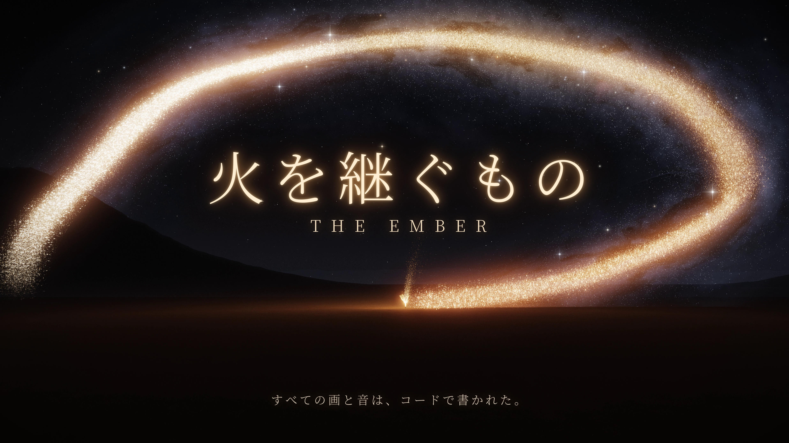
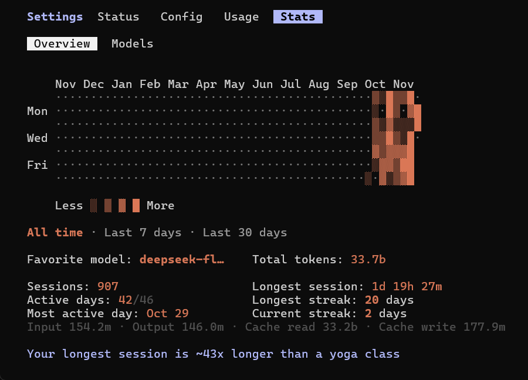

# SES業務・AI支援プラットフォーム 開発記録

## [▶ YouTubeで『火を継ぐもの / THE EMBER』を見る](https://youtu.be/LClEYrYi6n0)

映像と音をコードで表現した4K短編映画です。

## [▶ YouTubeで『時代への挑戦』を見る](https://youtu.be/8cDl6dlNM2M)

企画・構成・演出を自ら手がけ、生成AIと協働して制作したオリジナルMVです。

## プロジェクトの概要

日本のSES企業を想定した個人開発の業務システムです。人事管理を土台に、職務経歴書の解析、案件マッチング、面談分析、AIによる営業判断支援へと機能を広げてきました。

**開発者**　郭 熙臣（コウ シーチェン）　／　**開発開始**　2025年10月

**[開発統計・システム規模](#開発記録の統計とシステムの規模)　／　[AI開発の運用ルール](#ai開発の運用ルール)　／　[バージョン別の記録](#各バージョンの主な機能)**

## 開発記録の統計とシステムの規模

### 開発記録の統計

※このリポジトリに掲載しているコミットを集計しています（同じSHAは1件として数えます）。種類はコミット件名の接頭辞による分類です。[集計方法](EXPORT_NOTES.md#開発統計の集計方法)

### システム開発規模（V1〜V8）

※5つの開発ブランチ間の重複を除外した、コミット済みのコードのローカル集計値（2026年11月11日時点）です。総行数にはテスト、検証用コード、ドキュメント、スクリプト等を含みます。外部依存ライブラリや生成済み成果物は除外しています。[集計方法](EXPORT_NOTES.md#システム開発規模の集計方法)

### 開発スタイルの変遷とAI活用実績

V1では、AIによるコーディング支援を意図的に使用せず、自分自身の技術力だけでどこまで業務システムを構築できるかを確かめました。

[V1の開発成果物（Proton Drive）](https://drive.proton.me/urls/J4KK81KYXM#p3Tczt3ldb9k)

V2以降はAIを段階的に導入し、現在は複数のAIモデルを役割に応じて使い分けながら、実装・調査・テスト・設計レビューを進めています。

Claude Codeの利用統計では、約1か月半で累計約337億トークンを記録しています（2026年11月4日時点のAll time表示値。キャッシュ読み込みを含み、Codexの独立利用分は含みません）。

## AI開発の運用ルール

設計資料と運用ルールを **921ファイル・約60MB** に整理し、役割と作業に応じて参照する資料を指定しています（2026年11月13日時点）。

- **役割と作業範囲**　担当エージェントごとに、行う作業と参照する資料を決めます。
- **権限と情報保護**　操作権限を管理し、機密情報を扱う作業や変更に確認手順を設けます。
- **品質確認**　テストと独立レビューで抜けや誤りを見つけ、最終判断と統合は開発者が行います。

### 運用ルールと資料構成の詳細

#### 独自の開発方法論：AIを使う側から、AIのルールを設計する側へ

私が重視しているのは、AIに大量のコードを書かせることそのものではありません。AIが正しく、速く、安定して働けるように、開発の仕組みを設計することです。

そのために、設計資料・開発規範・AIエージェント向けのSkill群をMarkdown形式で体系的に整備しており、その量は現在約60MB（921ファイル、約2,000万字）に達しています。A4用紙に片面で印刷して積み上げると、約2メートルに相当する分量です。

ただし、これらの資料をAIに一度に読み込ませることはしません。作業の内容に応じて必要な資料だけを選び出して参照させる仕組みにより、AIが迷わず、目の前の作業に集中できるようにしています。

ルールとして自ら設計・整備している主な領域は、次のとおりです。

- AIエージェントごとの役割分担と作業範囲
- 作業ごとに参照すべき資料の指定
- 操作権限の管理と、機密情報・個人情報の保護
- 誤操作や想定外の変更を防ぐための確認手順
- テスト・品質確認と、独立したレビューの進め方

AIの出力はそのまま採用しません。テストと独立レビューを組み合わせて検証し、誤った判断や手戻りを早い段階で防いでいます。その結果をもとに、ルール自体も継続的に改善しています。

これらのルールは、AIの能力を縛るためのものではありません。無駄な作業を減らし、AIがより速く、より安定して成果を出せるようにするためのものです。

AIを道具として使うだけでなく、AIがどのように仕事を進めるべきか、その仕組みそのものを設計する。それが私の開発スタイルです。

| 資料量（2026年11月13日時点） | |
|:---|:---|
| サイズ | 58.0 MB（60,835,754 バイト） |
| ディスク上のサイズ | 59.7 MB（62,681,088 バイト） |
| 内容 | 921 ファイル、464 フォルダ |

### 開発ノート

資料量を見る

| 資料量（2026年11月19日時点） | |
|:---|:---|
| サイズ | 109 MB（115,326,214 バイト） |
| ディスク上のサイズ | 115 MB（121,548,800 バイト） |
| 内容 | 3,158 ファイル、376 フォルダ |

## 各バージョンの主な機能

V5〜V7はV4を土台に並行開発し、現在はV8で各機能をつなぐデータ基盤を開発しています。V9・V10ではセキュリティの強化を構想しています。

| バージョン | 主な機能 | 開発記録 |
| :--- | :--- | :--- |
| V1 | 人事管理・認証・権限管理 | [V1基準版](COMMITS.md#c375) |
| V2 | 職務経歴書の解析・AIレビュー | [V2の記録を見る](versions/V2.md) |
| V3 | 案件管理・人材マッチング・営業支援 | [V3の記録を見る](versions/V3.md) |
| V4 | AIによる営業判断支援 | [V4の記録を見る](versions/V4.md) |
| V5 | 対話型AIアシスタント | [V5の記録を見る](versions/V5.md) |
| V6 | 面談内容の整理・共有 | [V6の記録を見る](versions/V6.md) |
| V7 | 業務データを組み合わせた提案支援 | [V7の記録を見る](versions/V7.md) |
| V8 | 各機能をつなぐ統合データ基盤（開発中） | [V8の記録を見る](versions/V8.md) |
| V9 | セキュリティ防護（構想） | 構想段階 |
| V10 | AIによるセキュリティ運用（構想） | 構想段階 |

各バージョンの概要

SES営業では、社員の経歴、案件の条件、提案や面談の経緯が担当者ごとに分散しやすく、過去の経験を次の提案に活かしにくいという課題があります。このシステムでは、人事・案件・営業活動の情報を一つの基盤で扱い、AIで業務を支援します。V1〜V8は別々のアプリではなく、同じ基盤に段階的に機能を追加・統合してきたものです。

- **V1　人事管理**：部門・社員・職歴の管理と、ログイン認証・権限管理。
- **V2　職務経歴書管理・AIレビュー**：形式の異なる職務経歴書を取り込み、AIを活用して管理。
- **V3　案件管理・人材マッチング・営業支援**：案件と技術者の情報を一元管理し、営業活動を支援。
- **V4　AIによる営業判断支援**：蓄積した営業データを活用し、提案の判断を支援。
- **V5　対話型AIアシスタント**：社内の問い合わせに対話で答えるAIアシスタント。
- **V6　面談分析**：面談の内容を整理・共有し、組織の知見として活用。
- **V7　提案支援**：業務データと面談情報を組み合わせ、提案を支援。
- **V8　統合データ基盤（開発中）**：V1〜V7をつなぎ、システム全体のデータを統合。
- **V9・V10（構想）**：セキュリティの強化。

## 開発記録の見方

開発用リポジトリの実際のコミット760件を、日時・コミットSHA・親コミット・バージョン・種類・AI共同作成者とともに1件ずつ掲載しています。

- [コミット一覧](COMMITS.md) ／ [日付別](BY_DATE.md)
- [CSV](data/commits.csv) ／ [JSON](data/commits.json)

記録について

- このリポジトリ自体のコミット履歴は、公開資料の更新履歴です。開発用リポジトリのコミットとは別のものです。
- ソースコード、コミットの内容、設計資料、開発ルールは掲載していません。
- 作成者名は「郭 熙臣」で統一しています（開発用リポジトリの作成者記録は、すべて本人のものです）。

[集計方法](EXPORT_NOTES.md)

## 主な使用技術

技術の一覧（テキスト）

- **バックエンド**：Java、Spring Boot、Python、FastAPI
- **フロントエンド**：Vue 3、JavaScript、Element Plus
- **データ**：MySQL、Redis、Elasticsearch
- **AI・RAG・エージェント**：Dify、RAGFlow、LangGraph、LLM、VLM、MCP、独自のエージェント制御
- **インフラ**：Docker、VMware、AWS S3、MinIO、Nginx
- **認証・権限・開発管理**：JWT、RBAC、Git、pytest

※一部の技術・機能は開発・検証中であり、使用技術は開発状況に応じて変更する場合があります。

## 開発の進め方

要件整理と設計は自ら担当し、AIエージェントと分担して実装・調査・テストを進めています。成果物はテストと独立レビューで確認し、統合と最終判断は自ら行っています。

面談では、実際の動作や開発環境もご紹介できます。
